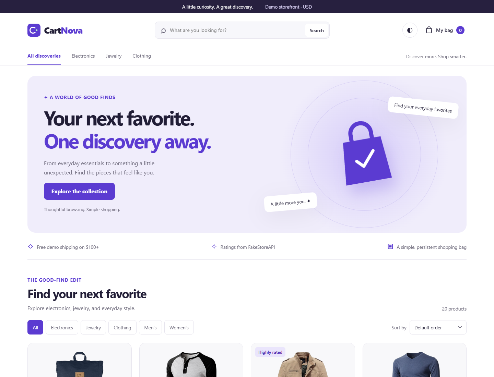
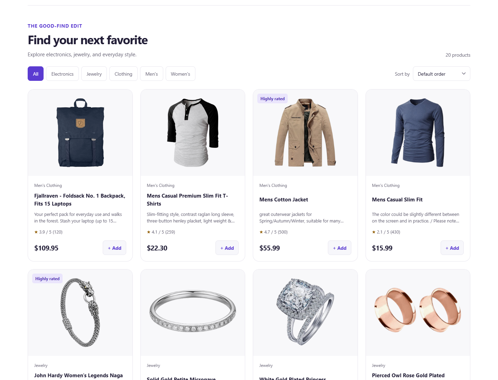
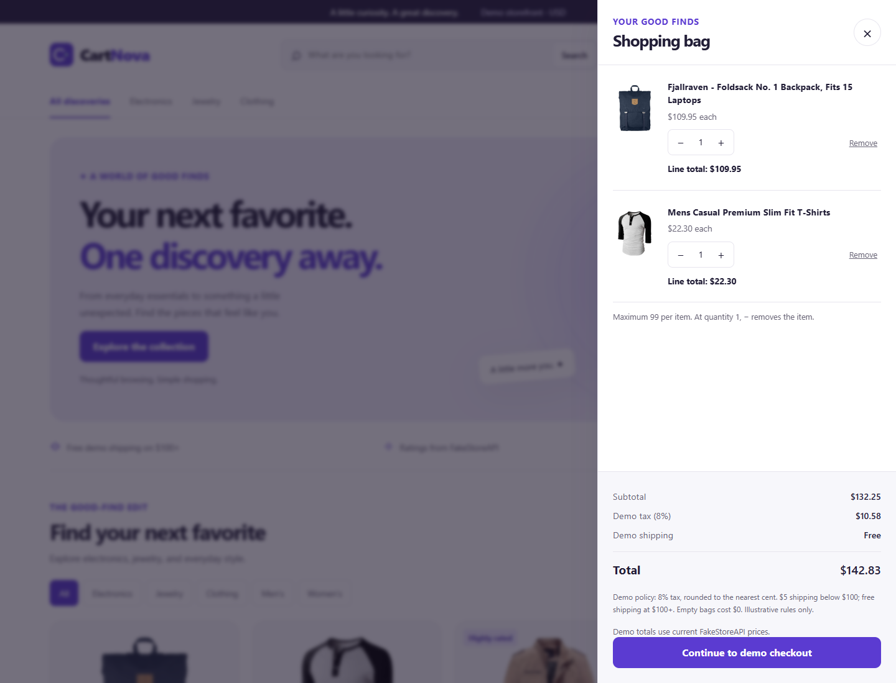
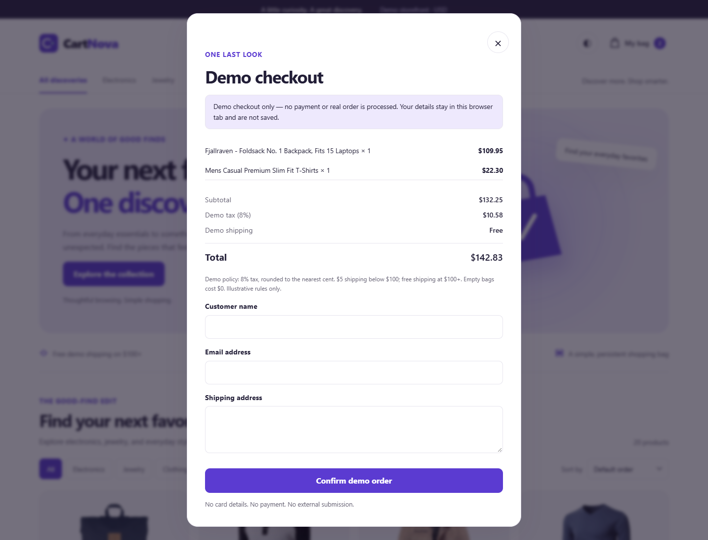

# CartNova

**Discover more. Shop smarter.**

Datheon Full Stack Web Development Internship — Batch 01, **Task 4: E-Commerce Product Catalog & Interactive Shopping Cart**.

Built by **Gloria Beneth Mbilinyi**, Dar es Salaam Institute of Technology (DIT).

[GitHub repository](https://github.com/gloria-mbilinyi/cartnova-datheon) · [GitHub Actions](https://github.com/gloria-mbilinyi/cartnova-datheon/actions) · [GitHub Pages address](https://gloria-mbilinyi.github.io/cartnova-datheon/)

The HTTPS deployment is verified. Production evidence and milestone status are recorded in [docs/STATUS.md](docs/STATUS.md).

## Overview and problem

CartNova makes a remote product catalog easy to explore while keeping shopping-bag state and monetary calculations consistent. It demonstrates a complete frontend shopping journey, from discovering a product to a clearly labeled local checkout simulation.

**Demo checkout only — no payment or real order is processed.** No payment details are collected, no order is sent to a backend, and customer fields are not persisted.

## Features

- Responsive storefront with a live product grid, real API prices, descriptions, ratings, and rating counts.
- Electronics, Jewelry, combined Clothing, Men's Clothing, and Women's Clothing filters.
- Search across titles, descriptions, and human-friendly categories; multiple search words must all match.
- Default API order, ascending/descending price, descending rating, and alphabetical sorting. Search, category, and sorting compose together.
- Accessible product-details dialog, image fallbacks, loading skeletons, retry controls, and empty states.
- Persistent slide-out shopping bag with duplicate additions, line removal, quantity changes, immediate badge updates, and current-price totals.
- Inline checkout validation, local demo references, confirmation, and cart clearing after successful simulation.
- Light/dark themes, visible keyboard focus, Escape-to-close, focus containment/restoration, reduced-motion support, and collapsible mobile filters.
- Cross-tab bag synchronization, corrupted-data recovery, unavailable-storage notices, and checkout protection when prices are unverified.

“Highly rated” is a disclosed UI rule: the supplied rating must be **4.5/5 or greater**. No discounts, inventory counts, delivery promises, or promotional product claims are generated.

## Technology and API

HTML5, CSS3 Grid/Flexbox, vanilla JavaScript ES modules, Fetch/async-await, AbortController, and localStorage. There are **no runtime dependencies**. Development uses Node.js 24+, Playwright, axe-core, and GitHub Actions/Pages.

The production app fetches [FakeStoreAPI products](https://fakestoreapi.com/products) directly. `api.js` enforces a 12-second timeout, cancellation, HTTP validation, JSON parsing, and schema validation. `products.js` validates IDs, supported categories, text, HTTPS image URLs, finite nonnegative prices, rating bounds, and rating counts. Duplicate IDs or invalid data reject the response with a friendly retry message.

API `jewelery` is displayed as **Jewelry**. Both API clothing categories are included by the combined **Clothing** filter. API images are loaded lazily with a local fallback if loading fails. API text is assigned with safe DOM APIs rather than interpreted as markup.

No synthetic product fixtures or fallback catalog are bundled into the application. The separate fixtures under `tests/fixtures/` are used only by deterministic tests. Live API connectivity is checked separately from those tests.

## State and shopping-bag persistence

`state.js` owns catalog/fetch state, query, category, sort choice, bag lines, and storage notices. Selectors derive visible products; pure cart operations return new arrays. UI updates subscribe to relevant transitions so quantity changes preserve keyboard focus.

The key `cartnova.cart.v1` stores only:

```json
{"version":1,"items":[{"productId":1,"quantity":2}]}
```

Saved prices are ignored. Current validated catalog data supplies every price. Missing IDs are removed after a successful catalog load; unresolved IDs are retained during a network failure, with prices and checkout unavailable. Invalid entries are discarded, duplicates are merged, and storage access/write failures retain a functional bag for the current tab with a notice.

Quantities are whole numbers from **1 to 99**. Decreasing quantity 1 removes the line; the drawer explicitly describes this behavior. The increment control disables at 99. Theme preference uses the separate `cartnova.theme.v1` key.

## Transparent demo calculations

Currency is **USD**. Prices are converted once to integer cents, rounding source sub-cent values to the nearest cent. All line totals and sums use cents.

| Component | Demo rule |
| --- | --- |
| Subtotal | Sum of current unit-price cents × quantity |
| Tax | 8% of subtotal, rounded once to the nearest cent |
| Shipping | $5 for nonempty bags below $100; free from $100 |
| Grand total | Subtotal + tax + shipping |
| Empty bag | $0 subtotal, tax, shipping, and total |

These are illustrative policies, not jurisdiction-specific tax or shipping rules. The drawer and checkout share the same calculation and totals-rendering modules.

## Simulated checkout and privacy

The form requires a name (2–100 characters), valid email (maximum 254 characters), and shipping address (8–500 characters). Submission validates the fields, a nonempty bag, current catalog status, quantities, product availability, and prices. Only then is a local `DEMO-…` reference generated and the cart cleared.

Personal fields stay in the form for the current dialog and are cleared on cancellation or successful simulation. They are never added to localStorage or submitted externally. Product API/image requests and normal GitHub Pages hosting requests are separate from checkout; this is a frontend demonstration with no payment or order backend.

## Setup and commands

```sh
git clone https://github.com/gloria-mbilinyi/cartnova-datheon.git
cd cartnova-datheon
npm ci
npm run dev
```

Open **http://127.0.0.1:4373/**. Use a web server because JavaScript modules require HTTP. The preview binds to the local computer and serves only public application paths.

| Command | Purpose |
| --- | --- |
| `npm run check` | JavaScript syntax and local HTML asset references |
| `npm test` | Deterministic unit and HTTP-server tests |
| `npm run test:browser` | Deterministic Playwright regression and axe checks |
| `npm run test:all` | Source checks, unit tests, and browser tests |
| `npm run test:live` | Independent, unmocked FakeStoreAPI request |
| `node scripts/live-check.mjs` | Unmocked browser catalog/cart/checkout verification |
| `node scripts/live-check.mjs --screenshots` | Capture the actual live-data application |
| `npm run build` | Produce an allowlisted static release in `dist/` |

On Windows, browser tests use installed Google Chrome. On other platforms install the browser with `npx playwright install --with-deps chromium`. `PLAYWRIGHT_CHANNEL` overrides the browser channel. `BASE_URL` runs deterministic tests against an existing deployment. The live browser script accepts `CARTNOVA_BASE_URL`, `CARTNOVA_EVIDENCE_DIR`, and `CARTNOVA_EXPECTED_SHA`.

## Architecture

```text
index.html                  Semantic storefront and native dialogs
css/                        Tokens, base, navigation, storefront, grid, dialogs, theme
js/api.js                   Validated, abortable FakeStoreAPI transport
js/products.js              External-data normalization
js/filters.js, search.js,
  sorting.js, state.js       Pure selectors and central state
js/cart.js, cart-storage.js  Cart operations and versioned persistence
js/calculations.js          Pure integer-cent demo calculations
js/catalog.js, details.js,
  cart-view.js,
  checkout-view.js,
  totals-view.js            Safe DOM rendering
js/checkout.js              Customer validation and local order simulation
js/ui.js, theme.js,
  utils.js, app.js           Dialog behavior, preferences, shared helpers, composition
assets/icons/               Local vector icon and image fallback
assets/screenshots/         Actual application captures using live API data
tests/*.test.js              Unit/HTTP tests
tests/browser/              Playwright interactions, responsive and accessibility checks
tests/fixtures/             Synthetic test data; excluded from deployment
scripts/                    Preview, checks, build, and separate live verification
.github/workflows/          Verification and Pages workflow
docs/STATUS.md              Milestone and verification record
```

## Screenshots

These are captures of CartNova running with real FakeStoreAPI responses, not mockups or test fixtures.






[Mobile](assets/screenshots/mobile.png) · [Tablet](assets/screenshots/tablet.png) · [320px view](assets/screenshots/narrow.png) · [Product details](assets/screenshots/details.png) · [Confirmation](assets/screenshots/confirmation.png)

## Testing evidence

Local execution and CI passed **40 unit/HTTP tests** and **31 Playwright tests**. All 31 browser tests also passed against the deployed HTTPS application. Coverage includes response validation, search/filter/sort composition, cart operations, storage failures, monetary boundaries, checkout, literal rendering of hostile markup, keyboard focus, image fallback, release-file exclusions, and responsive widths **1440/768/390/320px**. Automated axe checks cover the light storefront, cart, checkout, and dark storefront. Automated accessibility checks supplement manual keyboard checks; they are not a complete accessibility certification.

The separate live-browser checks fetched **20 products with HTTP 200**, verified a displayed current price and cart total, reloaded a persistent bag, completed the demo checkout, checked all four widths, and found no JavaScript runtime errors. Evidence is in [the screenshot capture record](assets/screenshots/live-evidence.json) and the [unmocked production record](docs/production-evidence.json), including the exact served commit. See [status](docs/STATUS.md) for production verification.

## CI/CD and free hosting

The GitHub Actions workflow verifies pushes and pull requests to `main` using a reproducible npm lockfile. The Pages workflow runs source checks, unit tests, Chromium regression tests, and the static build before deployment. Deployment is restricted to `main` after verification; pull requests do not deploy. Repository access is read-only during testing; Pages write and OIDC permissions are limited to the deployment job. Actions are pinned by commit SHA.

The release includes only `index.html`, CSS, browser JavaScript, and assets, plus build metadata. Source tooling, tests, fixtures, credentials, and `node_modules` are excluded. All asset/module paths are relative and support the `/cartnova-datheon/` Pages subdirectory. Free GitHub Pages provides HTTPS hosting.

## Known limitations

- FakeStoreAPI and its images are external services: outages, CORS changes, or upstream changes can prevent browsing. Retry is available; no made-up products or unverified-price checkout are used.
- Prices are verified when the current catalog is fetched; this demo has no inventory reservation, real stock check, customer accounts, payment, fulfillment, or order history.
- Browser storage is local to the browser/profile/origin. Clearing it removes the bag; private browsing and blocked storage may prevent persistence.
- Theme and cart preferences are the only persistent application data. The frontend has no server to store customer information.
- The default sort preserves API order; it does not claim merchandising, popularity, or discounts.
- Local automated browser execution used Chrome/Chromium. Compatibility with every browser and assistive technology has not been exhaustively audited.

## Developer

**Gloria Beneth Mbilinyi** · Dar es Salaam Institute of Technology (DIT)

[GitHub](https://github.com/gloria-mbilinyi) · [LinkedIn](https://www.linkedin.com/in/gloria-mbilinyi/) · Datheon Full Stack Web Development Internship — Batch 01
